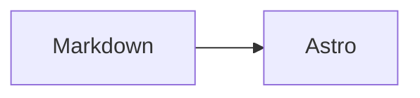

# Markdown 写作与样式

内容仅使用 `.md`，不支持 MDX、JSX 或组件导入。现有文章已迁移，公开 URL 保持不变。新文章使用：

```sh
bun run new:post --draft --folder --lang zh "文章标题"
```

表格、公式、代码块和图表参考 Duckquill；标准 GitHub Alerts 恢复 astro-pure Aside 的圆角边框、8px 强调边、原配色和图标。标题、正文、链接、列表、普通引用、图片及其他样式保持原样。代码高亮保留 astro-pure 原来的 One Light / One Dark Pro 配色，其余容器沿用站点主题变量。代码块样式独立维护在 `src/assets/styles/code-block.css`，其他限定样式集中在 `src/assets/styles/markdown.css`，Markdown 提示框由 `src/plugins/remark-alerts.ts` 转换，网站和 RSS 共用。

## 提示框

使用 GitHub 风格的块引用标记。支持 `NOTE`、`TIP`、`IMPORTANT`、`WARNING`、`CAUTION`。标记独占引用的第一行，中文说明可以在后续正文中加粗。

```md
> [!NOTE]
> 一段补充说明。

> [!TIP]
> **小技巧**
>
> 支持 **加粗**、`行内代码` 和 [链接](https://example.com)。

> [!IMPORTANT]
> **重要**
>
> 请先保存配置。

> [!WARNING]
> **注意**
>
> 操作前请阅读说明。
>
> - 支持列表
> - 支持多个段落

> [!CAUTION]
> **危险**
>
> 这项操作可能导致数据丢失。
```

GitHub Alerts 只改变编写语法，不再需要 MDX。原有 `Aside type="danger"` 迁移为 `CAUTION`，`type="caution"` 迁移为 `WARNING`，`type="note"` 迁移为 `NOTE`，保留中文标题和正文。

## 基础内容

使用标准 Markdown 标题、段落、引用、列表、表格、脚注和删除线。普通引用不添加提示框标记：

```md
> Stay hungry, stay foolish.

| 名称  | 说明         |
| ----- | ------------ |
| Astro | 静态站点构建 |

正文中的脚注[^example]。

[^example]: 脚注内容。
```

图片继续使用 ``，支持原有图片缩放。可在 `src/site.config.ts` 的 `content.imageCaption` 开启图片说明。标准 HTML 的 `<details>` / `<summary>` 可用于折叠内容；不使用 JSX 属性或组件语法。

## 代码、公式与图表

代码围栏保留语言高亮、复制、折叠和标题。参考 Duckquill，代码块使用常驻的语言 / 文件名标题栏和右侧复制按钮，默认不显示行号。表格保留原生满宽列布局，窄屏由外框横向滚动。例如：

````md
```ts title="example.ts"
const message = 'Hello'
```


````

公式使用 `$...$` 或 `$$...$$`，继续由 KaTeX 渲染。原有内容处理插件和 TOC 保持有效。

## 验证

```sh
bun run test
bun run lint
bun run build
bun run test:e2e
```

生产预览会生成并加载 Pagefind 搜索索引；开发模式保留搜索提示。浏览器测试不提交真实评论。

构建默认使用 `astro build --force` 清除内容层缓存，确保 Markdown 插件修改后生成最新 HTML，避免本地重复编译仍显示旧提示框或旧代码结构。
