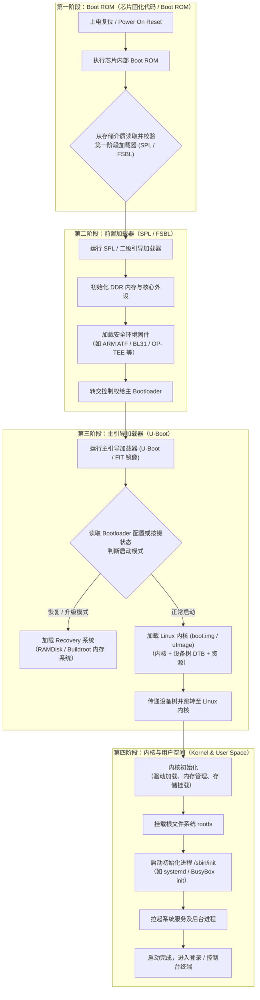

## 启动流程

嵌入式 Linux 的启动是一个**多阶段接力**的过程：每一级加载器只做自己力所能及的事（初始化有限的硬件、把下一级搬到内存），再把控制权交给下一级，直到内核接管并挂载根文件系统。下图概括了从芯片上电到进入登录终端的完整链路：



### 第一阶段：Boot ROM

- 上电复位（Power On Reset）后，CPU 从**芯片内部固化的 ROM** 取指执行，这段代码由芯片厂商提供且不可修改。
- 负责最基础的初始化：时钟、引脚复用、片内 SRAM，以及用于输出启动日志的串口。
- 从存储介质（SPI Flash / eMMC / SD 卡）读取**第一阶段加载器**，并做完整性校验（校验和 / 签名）。
- 此时 DDR 尚未初始化，可用内存仅有很小的片内 SRAM，因此该加载器必须足够小，通常只做"搬运"工作。

### 第二阶段：SPL / FSBL

- **SPL**（Secondary Program Loader）/ **FSBL**（First Stage Boot Loader）运行在片内 SRAM 上。
- 完成 **DDR 内存控制器**与核心外设（时钟、存储控制器）的初始化，为加载大体积镜像提供内存空间。
- 加载**安全环境固件**：ARM Trusted Firmware 的 BL31（运行时安全监控）、BL32（OP-TEE 安全系统），以及作为 BL33 的 U-Boot。
- 最后把控制权交给主 Bootloader（U-Boot）。

### 第三阶段：主引导加载器（U-Boot）

- U-Boot 运行在 DDR 中，功能完备：支持命令行交互、网络下载（TFTP / NFS）、文件系统读写（FAT / ext4）等。
- 读取启动配置或按键 / GPIO 状态，决定进入**正常启动**还是**恢复 / 升级模式**（Recovery）。
- 加载内核镜像（FIT 包 `boot.img` / `uImage`）与设备树 DTB，设置 `bootargs`（cmdline），随后跳转到内核入口。

### 第四阶段：内核与用户空间

- 内核完成驱动加载、内存管理、时钟与外设初始化，并根据 `bootargs` 决定根文件系统的位置与类型。
- 挂载根文件系统 `rootfs`；若需要，先挂载 initramfs 作为过渡，完成驱动加载、解密等前置操作。
- 启动第一个用户态进程 `/sbin/init`（systemd / BusyBox init），由其拉起系统服务、挂载其余文件系统。
- 全部服务就绪后进入登录 / 控制台终端，启动完成。

## rootfs 制作
**rootfs**（Root Filesystem，根文件系统）是类 Unix 操作系统（如 Linux）启动后挂载的第一个文件系统，包含 `/bin`、`/etc`、`/lib`、`/usr` 等目录，是用户空间程序运行的基础。

### 常见根文件系统方案

| 方案 | 特点 | 适用场景 |
| --- | --- | --- |
| Buildroot / BusyBox | 体积极小（几 MB），可一并生成工具链 | 资源受限的嵌入式设备 |
| Debian / Ubuntu Base | 软件包丰富，可直接 `apt install` | 资源较充裕、需要完整发行版环境 |
| Yocto / OpenEmbedded | 高度可定制、可复现构建 | 商业产品与长期维护项目 |

### 获取 Base RootFS

直接下载对应架构的 base 压缩包即可，然后解压到指定文件夹（以 `rootfs` 为例）：

```bash
mkdir -p rootfs
sudo tar -xpf ubuntu-base-24.04.5-base-arm64.tar.gz -C rootfs
```

> 建议使用 `-p` 保留权限位，且**以 root 身份解压**；否则 `/usr/bin/sudo` 等文件的属主与 setuid 位会丢失。

### 准备Chroot环境

> **chroot**（Change Root）是 类 Unix 操作系统中的一个系统调用及命令行工具。它的作用是**改变当前进程及其子进程的根目录视场**，将指定的某个子目录“伪装”成整个系统的根目录（`/`）

#### 注入QEMU（可选）

如果宿主机的架构与目标镜像的架构不同（例如在 x86_64 主机上制作 arm64 镜像），需要借助 QEMU 用户态模拟来执行目标架构的程序：

```bash
# 安装 QEMU 用户态模拟与 binfmt 自动注册
sudo apt install qemu-user-static binfmt-support

# 将静态编译的 QEMU 拷入目标根文件系统
sudo cp /usr/bin/qemu-aarch64-static "$TARGET_ABS/usr/bin/"

# 验证 binfmt 已注册（应能看到 aarch64 条目）
ls /proc/sys/fs/binfmt_misc/ | grep aarch64
```

#### Mount 虚拟文件系统

为了让 chroot 环境内的 `apt`、`systemd` 等程序正常工作，必须把宿主机的虚拟文件系统挂载进去：

1. 设置环境：

```bash
# 创建 /proc、/sys、/dev/pts 目录供后续挂载
sudo mkdir -p "$TARGET_ABS"/{proc,sys,dev/pts}

# 挂载宿主机的对应路径到当前虚拟系统中（/proc、/sys、/dev/pts）
sudo mount -t proc proc "$TARGET_ABS/proc"
sudo mount -t sysfs sys "$TARGET_ABS/sys"
sudo mount -o bind /dev "$TARGET_ABS/dev"
sudo mount -o bind /dev/pts "$TARGET_ABS/dev/pts"
```

2. 进入虚拟文件系统

```bash
# 使用chroot将根目录切换到解压的路径（rootfs）
sudo chroot "$TARGET_ABS" /bin/bash -e
```

3. 配置基础环境：

```bash
# 1. 更新依赖
apt update && apt upgrade -y

# 2. 设置 dns、网络、时区、语言等配置
echo "nameserver 223.5.5.5" > /etc/resolv.conf
ln -sf /usr/share/zoneinfo/Asia/Shanghai /etc/localtime
echo "Asia/Shanghai" > /etc/timezone

# 3. 安装所需的软件
apt install -y sudo vim ssh net-tools iproute2

# 4. 设置用户和密码（示例：创建 ubuntu 用户并加入 sudo 组）
useradd -m -s /bin/bash -G sudo ubuntu
passwd ubuntu
passwd root
```

> 若 chroot 内需要联网，把宿主机的 DNS 配置拷入即可：`sudo cp /etc/resolv.conf "$TARGET_ABS/etc/resolv.conf"`。

4. 退出虚拟文件系统：

```bash
# 1. chroot 退出
exit

# 2. 取消挂载（顺序与挂载时相反）
sudo umount "$TARGET_ABS/dev/pts"
sudo umount "$TARGET_ABS/dev"
sudo umount "$TARGET_ABS/sys"
sudo umount "$TARGET_ABS/proc"

# 3. 删除 qemu
sudo rm -f "$TARGET_ABS/usr/bin/qemu-aarch64-static"
```

5. 最终打包：

```bash
# 方式一：打包为 tar 压缩包（保留权限）
sudo tar -cpf rootfs.tar -C "$TARGET_ABS" .

# 方式二：制作 ext4 镜像文件（-d 可直接从目录生成，无需 mount）
dd if=/dev/zero of=rootfs.img bs=1M count=4096
mkfs.ext4 -L rootfs -d "$TARGET_ABS" rootfs.img

# 方式三：制作只读 squashfs（体积更小）
sudo mksquashfs "$TARGET_ABS" rootfs.squashfs -comp xz
```

## uboot

**U-Boot**（Universal Boot Loader）是一个开源的、功能强大的**嵌入式系统引导加载程序**，相当于电脑（PC）上的 **BIOS / UEFI**。

### 启动阶段

U-Boot 通常分为多级构建，以适配不同容量约束：

| 阶段 | 典型产物 | 运行位置 | 说明 |
| --- | --- | --- | --- |
| TPL | `tpl.bin` | 片内 SRAM | 少数平台需要，初始化最基础的时钟 |
| SPL | `u-boot-spl.bin` | 片内 SRAM | 初始化 DDR，加载 U-Boot 主体 |
| Proper | `u-boot.bin` | DDR | 功能完整的引导程序 |

### 常用命令

```bash
# 查看 / 修改 / 保存环境变量
printenv
setenv bootargs 'console=ttyS0,115200 root=/dev/mmcblk0p2 rootwait rw'
saveenv

# 存储设备操作
mmc dev 0                        # 切换 MMC 设备
mmc part                         # 查看分区
ls mmc 0:1 /                     # 列出分区内文件
fatload mmc 0:1 0x40000000 Image # 加载文件到内存

# 启动内核
bootm 0x40000000                        # 启动 uImage / FIT 镜像
booti 0x40000000 - 0x50000000           # 启动 arm64 Image + DTB

# 网络下载
tftp 0x40000000 Image
```

### FIT 镜像

**FIT**（Flattened Image Tree）是 U-Boot 推荐的镜像格式：用 `.its` 描述文件把内核、设备树、ramdisk 等打包为单个镜像（`.itb`），并支持签名校验。

```bash
# 打包 FIT 镜像 / 查看内容
mkimage -f kernel.its kernel.itb
dumpimage -l kernel.itb
```

`kernel.its` 示例：

```dts
/dts-v1/;

/ {
    description = "Linux kernel FIT image";
    #address-cells = <1>;

    images {
        kernel {
            description = "Linux kernel";
            data = /incbin/("Image");
            type = "kernel";
            arch = "arm64";
            os = "linux";
            compression = "none";
            load = <0x40080000>;
            entry = <0x40080000>;
            hash-1 { algo = "sha256"; };
        };
        fdt {
            description = "Device tree";
            data = /incbin/("board.dtb");
            type = "flat_dt";
            arch = "arm64";
            compression = "none";
            hash-1 { algo = "sha256"; };
        };
    };

    configurations {
        default = "conf-1";
        conf-1 {
            description = "Linux kernel + DTB";
            kernel = "kernel";
            fdt = "fdt";
        };
    };
};
```

### 编译与烧录

```bash
# 配置与编译（以 64 位 ARM 为例）
make <board>_defconfig
make CROSS_COMPILE=aarch64-linux-gnu- -j"$(nproc)"

# 合并 SPL 与 U-Boot 为可烧录镜像（Rockchip 平台示例）
tools/mkimage -n rk3588 -T rksd -d spl/u-boot-spl.bin idbloader.img
cat u-boot.itb >> idbloader.img
```

## boot

**boot.img**（或 FIT 包）是承载**内核、设备树、可选的 initramfs** 的启动镜像，由 U-Boot 加载后交给内核执行。

### 镜像内容

| 组成部分 | 说明 |
| --- | --- |
| Kernel | 压缩或未压缩的内核镜像（`Image` / `zImage` / `Image.gz`） |
| DTB | 设备树二进制，描述硬件资源与内核启动参数 |
| Initramfs（可选） | 内存根文件系统，用于挂载真正 rootfs 之前完成驱动加载、解密等操作 |

### 制作方式

```bash
# 方式一：FIT 镜像（推荐，支持签名校验）
mkimage -f kernel.its boot.img

# 方式二：Android boot image 格式
mkbootimg --kernel Image --ramdisk initramfs.cpio.gz --dtb board.dtb \
    --cmdline 'console=ttyS0,115200 root=/dev/mmcblk0p2 rootwait rw' \
    --header_version 2 -o boot.img

# 查看 / 解包
unpack_bootimg --boot_img boot.img --out boot_out
```
